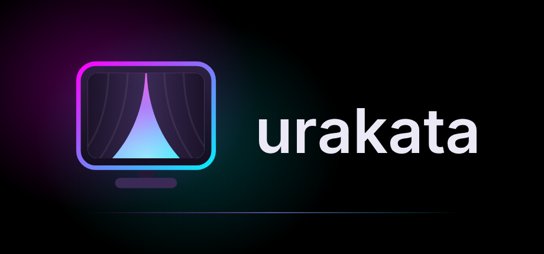
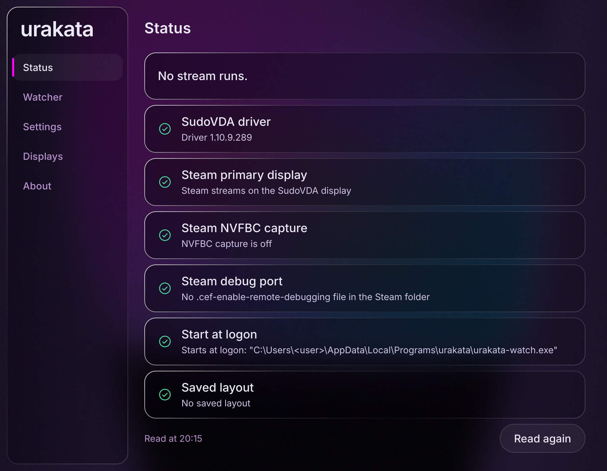

<p align="center">
  
</p>

# urakata

Display helper for Steam Remote Play (Steam Link) on Windows.

Steam does the streaming. urakata does the stage work around it:

- It installs the **SudoVDA** driver. Steam uses it to make a display
  that fits your client (phone, tablet, laptop, TV).
- During a stream, it turns your other displays off. Windows and games
  then open on the screen you see.
- After the stream, your displays come back in their usual layout.

*urakata* (裏方) is the Japanese word for the backstage crew of a theater.

<p align="center">
  
</p>

## Features

- **Watcher:** runs in the background from logon, with a tray icon.
- **Settings window:** setup checks, watcher control, settings.
- **Driver repair:** one button in the settings window.
- **Steam library entry:** opens the settings window from Big Picture and
  during a stream, with controller support.
- **Safe restore:** after a crash, a lost connection or sleep.
- **No Steam changes:** urakata changes no Steam files (except the
  optional library entry) and does not capture any picture.

## Requirements

- Windows 10 version 2004 or newer, or Windows 11, 64-bit. urakata was
  tested on Windows 11 with an NVIDIA graphics card only.
- Steam with SudoVDA support (Steam client from April 2026 or newer).
- Admin rights once, to install the driver.

## Install

1. Download `urakata-setup-<version>.exe` from the
   [latest release](https://github.com/Tokahiro/urakata/releases/latest).
2. Run it. The setup installs urakata for your Windows user only. Keep
   "Start the urakata watcher at each logon (recommended)" on.
3. On the "SudoVDA driver" page, install the bundled driver. Windows asks
   for admin rights once.
4. Set Steam up as shown in [Setup](docs/setup.md): SudoVDA as the primary
   display while streaming, and NVFBC capture off.

The setup and the programs are not signed yet, so Windows SmartScreen
can warn on the first start. See [Install](docs/install.md#smartscreen).

## Usage

Start a stream as usual. The watcher does the rest. To check the setup,
open **urakata** from the Start menu, or run:

```powershell
& "$env:LOCALAPPDATA\Programs\urakata\urakata.exe" status
```

## Documentation

- [Install, update and uninstall](docs/install.md)
- [Setup and daily use](docs/setup.md)
- [Command line](docs/commands.md)
- [Troubleshooting](docs/troubleshooting.md)

## Contributing

See [CONTRIBUTING.md](CONTRIBUTING.md).

## License

GPL-3.0. See [LICENSE](LICENSE).

The installer includes the SudoVDA driver by SudoMaker (MIT and CC0, with
Microsoft sample code under MS-PL). See
[installer/THIRD-PARTY.txt](installer/THIRD-PARTY.txt).
