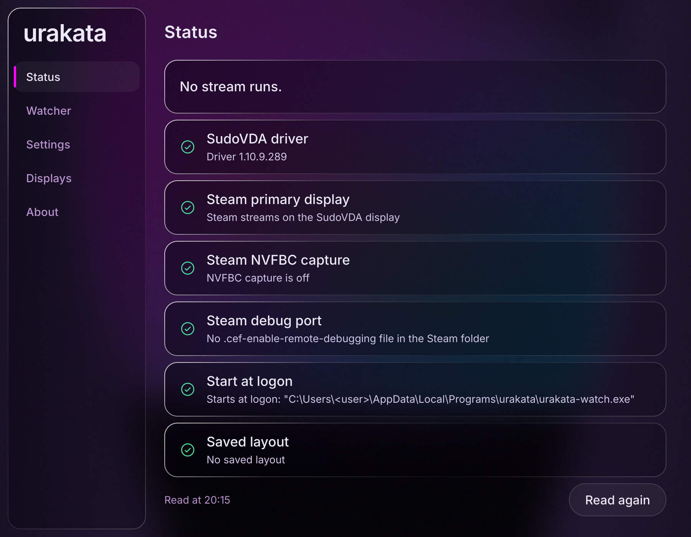
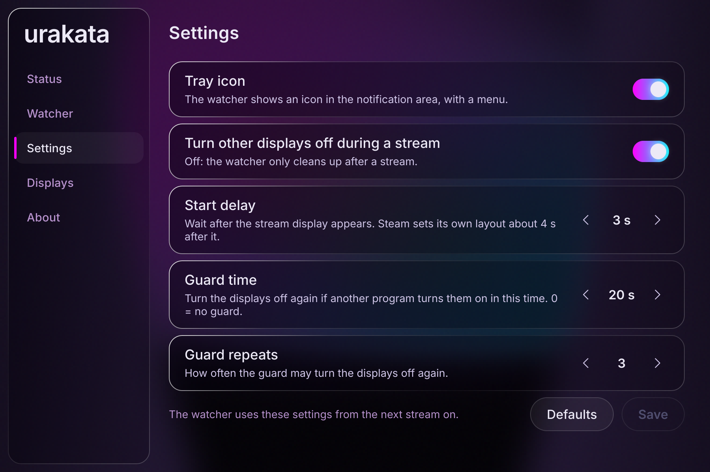

# Setup and daily use

- [First run](#first-run)
- [Stream as usual](#stream-as-usual)
- [The settings window](#the-settings-window)
- [The tray icon](#the-tray-icon)

## First run

Do these steps once, after the [install](install.md).

### 1. Set Steam up

1. Open Steam on the PC (the host).
2. Go to **Steam > Settings > Remote Play**. Turn on **Enable Advanced
   Host Options**, then open **Advanced Host Options**.
3. Set **Primary display while streaming** to **SudoVDA** (the list can
   show it with a number, for example "3: SudoVDA").
4. Turn off **Use NVFBC capture on NVIDIA GPU**. With NVFBC on, the
   picture on the SudoVDA display can break (missing windows, green
   areas).

### 2. Check the status

Open **urakata** from the Start menu. On the **Status** page, a yellow
warning says what to do. A question mark means urakata could not read
that part.



The checks:

| Check | What it means |
| --- | --- |
| SudoVDA driver | The driver is installed and works. On a problem, use the driver card on the **Displays** page. |
| Steam primary display | Steam streams on the SudoVDA display (step 1). |
| Steam NVFBC capture | NVFBC capture is off (step 1). |
| Steam debug port | A warning when Steam's remote debugging port is on. urakata does not need it. See [Troubleshooting](troubleshooting.md#steam-debug-port-warning). |
| Start at logon | The watcher starts when you log on to Windows. |
| Saved layout | A warning when a display layout from an earlier stream is still saved. The watcher removes it at its next start, or press **Restore** on the **Displays** page. |

Press **Read again** after you change something.

### 3. Add urakata to the Steam library (optional)

With this entry you can open the settings window from Big Picture and
from your client during a stream.

1. Exit Steam (**Steam > Exit**).
2. Open a terminal (PowerShell) and run:

   ```powershell
   & "$env:LOCALAPPDATA\Programs\urakata\urakata.exe" steam-entry --add
   ```

3. Start Steam. Your library now has **urakata**, with its own icon and
   artwork.

The entry is added for each Steam account on the PC. Your other
non-Steam games stay as they are.

## Stream as usual

Start a stream from your client as usual. You do not need to do anything
in urakata:

1. Steam makes a SudoVDA display that fits your client.
2. After a short delay (3 seconds by default), the watcher turns your
   other displays off. Only the stream display stays on.
3. When the stream ends, the other displays come back in their usual
   layout.

The tray icon shows an open curtain while a stream runs, and a closed
curtain without a stream.

If the client loses its connection (for example, you close the app or
lose Wi-Fi), Steam ends the stream only after about 3 to 4 minutes. Your
displays come back then. To get them back at once, use **Restore
displays** in the tray menu.

## The settings window

Open it from the Start menu, from the tray menu (**Open settings**), or
from the Steam library entry.

| Page | What you can do |
| --- | --- |
| Status | See the setup checks and whether a stream runs. |
| Watcher | Start or stop the watcher. Turn **Start at logon** on or off. |
| Settings | Change how the watcher works (see below). |
| Displays | Install or repair the SudoVDA driver. Restore the displays by hand. Open the folder with the log and the settings. |
| About | See the version. Look for updates. |



### Watcher settings

| Setting | Default | What it does |
| --- | --- | --- |
| Tray icon | On | Shows the watcher's icon in the notification area, with a menu. |
| Turn other displays off during a stream | On | Off: the watcher does not turn displays off. It only cleans up after a stream. |
| Start delay | 3 s | Wait after the stream display appears, so Steam can set its own layout first. |
| Guard time | 20 s | For this time after the start, the watcher turns the displays off again if another program turns them on. 0 turns the guard off. |
| Guard repeats | 3 | How often the guard may turn the displays off again. |

Press **Save**. The watcher uses the new settings from the next stream
on. **Defaults** sets all values back.

### Use it with a controller

When you open the window from the Steam library entry, it fills the
screen, so it fits Big Picture and the stream. It works with a
controller:

- D-pad or left stick: move between items.
- **A**: select.
- **B** (or **View**): back to the sidebar; from the sidebar, close the
  window.
- **LB** and **RB**: previous and next page.

## The tray icon

Right-click the urakata icon in the notification area:

- **Open settings**: opens the settings window.
- **Restore displays**: turns all displays on again in their usual
  layout. Use it if a stream left them off.
- **Stop watcher**: stops the watcher until the next logon, or until you
  start it on the **Watcher** page.

To hide the icon, turn off **Tray icon** on the **Settings** page. The
watcher keeps running.
